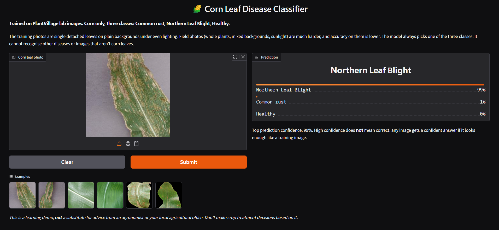
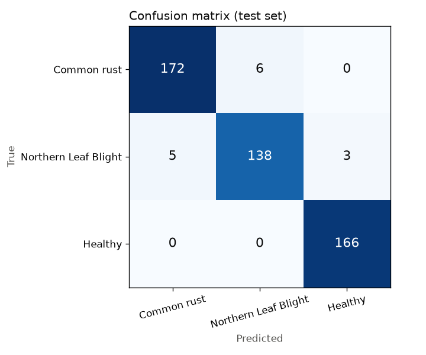
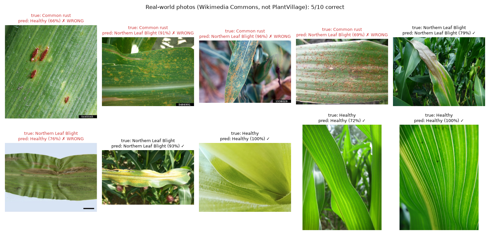

# 🌽 Corn Leaf Disease Classifier

Upload a photo of a corn leaf and get a probability for **Common rust**, **Northern Leaf Blight** or **Healthy**.

**▶ Live demo: [huggingface.co/spaces/HansTee89411/corn-leaf-disease-classifier](https://huggingface.co/spaces/HansTee89411/corn-leaf-disease-classifier)**



> This is a learning project trained on lab images. It is **not** a substitute for advice from an agronomist.

## What it does

A MobileNetV2 image classifier for three corn (maize) leaf classes from PlantVillage:

| Class | PlantVillage folder |
|---|---|
| Common rust | `Corn_(maize)___Common_rust_` |
| Northern Leaf Blight | `Corn_(maize)___Northern_Leaf_Blight` |
| Healthy | `Corn_(maize)___healthy` |

The app shows all three probabilities rather than only the top label, because a 51/49 answer and a 99/1 answer mean very different things. If the top probability is below 0.6, the app shows a warning that the model is uncertain.

## Dataset

[PlantVillage](https://www.kaggle.com/datasets/abdallahalidev/plantvillage-dataset), `color/` version: 3,339 images, all 256×256 RGB, with no corrupt files.

**These are lab photos, not field photos.** Each image shows a single detached leaf, photographed on a plain board or as a close-up, under even lighting. Real field photos show leaves still on the plant, other leaves and soil behind them, sun and shadow, and several diseases at once.

Data exploration (Phase 1, `python -m src.eda`) found three problems that would have quietly inflated the test score:

1. **The same photo appears several times.** Files like `R.S_HL 8189 copy.jpg` and `R.S_HL 8189 copy 2.jpg` are different crops of the same leaf photo. The 1,162 healthy images come from only 591 distinct photos. With a naive random split, 67% of healthy test images (28% overall) would have a crop of the same photo in the training set. **The split is therefore grouped by original photo** (`src/data.py`): every crop of a photo, and its neighbours in camera numbering, go to the same split. The split is 2,350 / 499 / 490 images.
2. **Black backgrounds give away the rust label.** In PlantVillage's own `color/` release, 1,188 of 1,192 Common rust images have their background cut out and filled with pure black. Only 2 of 985 blight images and none of the healthy images do. A model can score near 100% by detecting black corners.
3. **Healthy images are all close-ups.** Every healthy photo fills the frame with leaf surface, while the disease photos show whole leaves on a board. This is built into the dataset and can't be fixed by re-splitting.

## How the background shortcut was handled

| Run | What changed | Test accuracy | Blight leaves called "rust" when shown on a rust-style background |
|---|---|---|---|
| 1 | Black background replaced with a random colour (train) or grey (val/test) | 98.16% | **62.3%** |
| 2 (deployed) | + half the blight training and validation images swapped for PlantVillage's cut-out versions | **97.14%** | **12.3%** |

Run 1's higher score came partly from the shortcut. Replacing the black wasn't enough: rust images were still the only cut-out leaves, and the model learned that cut-out look as "rust". Run 2 puts cut-out leaves into both disease classes, so the model has to read the lesions. **The 1-point drop in accuracy is the honest number.**

The shortcut test (`shortcut_test` in `src/train.py`) takes the 146 blight test leaves and shows them on the backgrounds rust images have:

| Blight test leaves shown on… | → Rust | → Blight | → Healthy |
|---|---|---|---|
| their original photo | 3.4% | 94.5% | 2.1% |
| a black background | 10.3% | 84.9% | 4.8% |
| the grey fill used for rust at test time | 12.3% | 87.0% | 0.7% |

There is still some residual effect: 12.3% of blight leaves are called rust on grey, against 3.4% in their original photos.

## Model

- **MobileNetV2** pretrained on ImageNet, fine-tuned in two stages on a CPU (24 threads):
  - **Stage 1:** pretrained network frozen, only a new head trained (GlobalAveragePooling → Dropout 0.2 → Dense 3). Adam at 1e-3.
  - **Stage 2:** layers 100 and above unfrozen, Adam at 1e-5. Early stopping kept the epoch-11 weights.
- **2,261,827 parameters** (1,865,283 trainable in stage 2). The model file is **9.6 MB**.
- Augmentation (flip, rotation, zoom, contrast) and MobileNetV2's [-1, 1] input scaling are layers **inside** the model, so the app passes raw 0–255 pixels.
- **Training time:** 6.2 minutes wall-clock for run 2. Stage 1 took about 22 s per epoch, stage 2 about 31 s per epoch.

## Results (PlantVillage held-out test set, n = 490)

**Accuracy: 97.14%**

| Class | Precision | Recall | F1 | Test images |
|---|---|---|---|---|
| Common rust | 0.9718 | 0.9663 | 0.9690 | 178 |
| Northern Leaf Blight | 0.9583 | 0.9452 | 0.9517 | 146 |
| Healthy | 0.9822 | 1.0000 | 0.9910 | 166 |



The [10 most confidently wrong predictions](docs/confident_mistakes.png) fall into two groups:

- **Rust and blight confused with each other.** Many PlantVillage leaves carry both rust pustules and blight lesions, so even the labels are ambiguous.
- **Blight close-ups called "Healthy".** The model partly learned "close-up = healthy" from the dataset's framing.

## Limitations

**PlantVillage vs real-world accuracy: 97% drops to 50%.**

| Test set | Accuracy |
|---|---|
| PlantVillage held-out test (n = 490) | **97.14%** |
| Real-world corn photos from Wikimedia Commons (n = 10) | **50%** (5/10) |
| All 25 eligible real-world photos | 44% (11/25) |

Random guessing would score 33%. [Full write-up with images](docs/real_world_test.md).

**It can't detect common rust in real photos.** It got 0 of 4 chosen rust photos and 2 of 15 overall; most were called "Northern Leaf Blight", often at over 90% confidence. The cause is in the data. Every PlantVillage rust image is a leaf cut out from its background, so the model has never seen rust in a normal photo, and to it "a natural photo of a leaf with brown spots" means blight. Training on cut-out blight images fixed this *within* PlantVillage, but it can't teach what natural-photo rust looks like.

**The confidence warning doesn't catch real-world errors.** All 5 wrong real-world answers were above the 0.6 threshold (66–96%).



**It always answers, even for things that aren't corn leaves.** There is no "unknown" class, so every image gets three probabilities that sum to 1. Actual app output ([details](docs/non_corn/README.md)):

| Input | Output | Warning shown? |
|---|---|---|
| A portrait of a person | Northern Leaf Blight **52.19%**, Common rust 34.56%, Healthy 13.24% | Yes ("Uncertain (52% top confidence)") |
| The matplotlib logo | Northern Leaf Blight **96.31%**, Common rust 2.30%, Healthy 1.39% | **No** |

The confidence warning caught the portrait but missed the logo. High confidence doesn't mean the image is a corn leaf.

**It only knows 3 diseases.** PlantVillage has 4 corn classes; this model leaves out Cercospora / Gray leaf spot. Many corn diseases are in neither, such as southern rust, downy mildew and banded leaf and sheath blight. A leaf with any of those gets labelled as one of the three classes anyway.

**It was trained on lab conditions, not field conditions.** Every training image is one detached leaf, centred, on a uniform board or as a frame-filling close-up, under even lighting. Field photos add whole plants, overlapping leaves, soil and sky backgrounds, harsh sun and shadow, motion blur, and several diseases at once. None of those appear in training.

**Dataset shortcuts.** The training data's backgrounds and framing differ by class (see above). The worst of it has been reduced and measured, but the close-up framing of healthy images couldn't be fixed with this data.

## Philippine context

Corn is the Philippines' second-largest crop after rice, so corn disease detection is relevant here. But this model is narrow: three classes, lab images.

PlantVillage contains **no rice, banana, mango or coconut**, the crops that matter most locally. Nothing here carries over to them directly. Extending this to rice would need a different, rice-specific dataset, not more training on PlantVillage.

## What I'd do next

**A rice leaf disease classifier trained on a rice-specific dataset, ideally field-condition photos taken in actual paddies** rather than lab shots. The real-world test above shows why field images matter: training data photographed in one controlled way produces a model that fails on everything else. Rice is the most important crop in the Philippines, and a model that works on field photos is the version of this project that would actually help farmers. The leakage checks, grouped split and shortcut test from this project carry over directly.

## License

Code and model: [MIT](LICENSE). The photos in `docs/real_world/` and `docs/non_corn/` are third-party works under their own licences; see [docs/real_world_test.md](docs/real_world_test.md#image-credits) and [docs/non_corn/README.md](docs/non_corn/README.md).

## Run it locally

```bash
python -m venv .venv && .venv\Scripts\activate      # Windows
pip install -r requirements.txt
python app.py                                         # http://127.0.0.1:7860
```

To reproduce training, download PlantVillage into `data/` (not committed) and run `python -m src.eda`, then `python -m src.train --quick`, then `python -m src.train`. Install the extra training packages with `pip install -r requirements-train.txt`.

## Project layout

```
app.py              Gradio app
src/config.py       class names, image size, paths, SEED=42
src/data.py         grouped train/val/test split, background fix
src/eda.py          Phase 1 data exploration
src/train.py        two-stage MobileNetV2 training + evaluation + shortcut test
models/             trained model, class_names.json, metrics.json
docs/               charts, examples, non-corn test, real-world test
```
