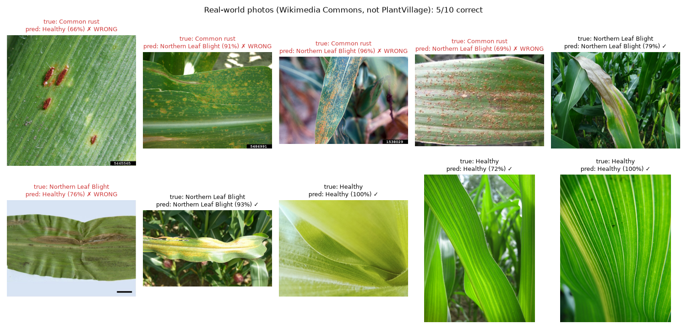

# Real-world test

The model reached 97.14% on PlantVillage's held-out test set. This page checks how it does on corn leaf photos that are **not** from PlantVillage.

## How the photos were chosen

- **Source:** [Wikimedia Commons](https://commons.wikimedia.org), 2026-11-09. The true labels are the disease names in each uploader's caption: *Puccinia sorghi* means common rust, and *Exserohilum turcicum* means Northern Leaf Blight. Most rust photos come from plant pathologists via Bugwood.org.
- **Screening:** 30 candidates were screened by eye **before** any were run through the model.
  - 4 were excluded because they're botanical drawings or microscope spore images, not leaf photos.
  - 1 was excluded because its leaves are curled by heat stress, so it isn't a fair "healthy" example.
- **Selection:** 10 of the remaining 25 were picked as photos a person might plausibly upload (4 rust, 3 blight, 3 healthy). This was also done before seeing any predictions.
- **Selection-bias check:** all 25 eligible photos were also run and are reported below.
- **Method:** predictions come from `predict()` in `src/inference.py`, the same function the deployed app calls, so preprocessing is identical.

## Results: the 10 chosen photos

| # | Image | True label | Prediction | Confidence | Correct? |
|---|---|---|---|---|---|
| 1 | [rust_1](real_world/rust_1.jpg) | Common rust | Healthy | 66.5% | ✗ |
| 2 | [rust_2](real_world/rust_2.jpg) | Common rust | Northern Leaf Blight | 90.9% | ✗ |
| 3 | [rust_3](real_world/rust_3.jpg) | Common rust | Northern Leaf Blight | 96.2% | ✗ |
| 4 | [rust_4](real_world/rust_4.jpg) | Common rust | Northern Leaf Blight | 69.3% | ✗ |
| 5 | [blight_1](real_world/blight_1.jpg) | Northern Leaf Blight | Northern Leaf Blight | 78.8% | ✓ |
| 6 | [blight_2](real_world/blight_2.jpg) | Northern Leaf Blight | Healthy | 76.3% | ✗ |
| 7 | [blight_3](real_world/blight_3.jpg) | Northern Leaf Blight | Northern Leaf Blight | 92.5% | ✓ |
| 8 | [healthy_1](real_world/healthy_1.jpg) | Healthy | Healthy | 100.0% | ✓ |
| 9 | [healthy_2](real_world/healthy_2.jpg) | Healthy | Healthy | 72.1% | ✓ |
| 10 | [healthy_3](real_world/healthy_3.jpg) | Healthy | Healthy | 100.0% | ✓ |

**5 / 10 correct (50%).** By class: rust 0/4, blight 2/3, healthy 3/3.

## All 25 eligible photos

| Class | Correct | What the wrong ones were called |
|---|---|---|
| Common rust | **2 / 15** | 11 × Northern Leaf Blight, 2 × Healthy |
| Northern Leaf Blight | 4 / 5 | 1 × Healthy |
| Healthy | 5 / 5 | n/a |
| **Total** | **11 / 25 (44%)** | |

The larger set agrees with the chosen 10, so the result isn't an artefact of which photos were picked.

## Comparison

| Test set | Images | Accuracy |
|---|---|---|
| PlantVillage held-out test | 490 | **97.14%** |
| Real-world photos (chosen) | 10 | **50%** |
| Real-world photos (all eligible) | 25 | **44%** |

With 3 classes, guessing at random would score 33%.

## What the failures have in common

**1. Rust in a normal photo is called "Northern Leaf Blight".** This happened to 3 of 4 chosen rust photos and 11 of 15 overall, often with over 90% confidence. It comes straight from the dataset. In PlantVillage, *every* Common rust image is a leaf cut out from its background, while blight images are normal photos. The model has never seen rust in a normal photo. To it, "a natural photo of a leaf with brown spots" means blight, because blight is the only disease it has seen photographed that way.

Training on cut-out blight images removed that cue *within* PlantVillage: blight leaves on a grey background are now called rust only 12.3% of the time, down from 62.3%. But it can't teach the model what rust looks like in a normal photo. This dataset has no such images.

**2. Lesions without PlantVillage's grey board are called "Healthy".** This happened with the close-up of four rust pustules (rust_1) and the blight leaf scanned on a light-blue background (blight_2). In training, "Healthy" was the class that never had the board.

**3. The correct "Healthy" answers may be right for the wrong reason.** Every healthy training image is a frame-filling close-up of green leaf. Field photos of healthy leaves look like that too, so 5/5 healthy is partly explained by framing. The model also called two diseased leaves "Healthy".

**4. The confidence warning didn't help.** All 5 wrong answers among the chosen 10 were above the app's 0.6 warning threshold (66–96%). On real photos, the model is confidently wrong.

## Bottom line

On real photos, this model can't be trusted to detect common rust: it gets 2 of 15 and mostly mistakes rust for blight. That's a property of PlantVillage's corn data, not something more training on it would fix. A useful model would need rust photographed in natural conditions.

## Image credits

All images are from Wikimedia Commons and were resized by Wikimedia (800 px). They're redistributed here unmodified under their original licences, which are separate from this repo's MIT licence.

| File | Author | Licence | Source |
|---|---|---|---|
| rust_1.jpg | Daren Mueller, Iowa State University, Bugwood.org | CC BY 3.0 US | [File:Puccinia sorghi (04).jpg](https://commons.wikimedia.org/wiki/File:Puccinia_sorghi_(04).jpg) |
| rust_2.jpg | Larry Osborne, Bugwood.org | CC BY 3.0 US | [File:Puccinia sorghi (06).jpg](https://commons.wikimedia.org/wiki/File:Puccinia_sorghi_(06).jpg) |
| rust_3.jpg | University of Georgia Plant Pathology, Bugwood.org | CC BY 3.0 US | [File:Puccinia sorghi (08).jpg](https://commons.wikimedia.org/wiki/File:Puccinia_sorghi_(08).jpg) |
| rust_4.jpg | Daren Mueller, Iowa State University, Bugwood.org | CC BY 3.0 US | [File:Puccinia sorghi Schwein. 5465563.jpg](https://commons.wikimedia.org/wiki/File:Puccinia_sorghi_Schwein._5465563.jpg) |
| blight_1.jpg | Jerzy Opioła | CC BY-SA 4.0 | [File:Exserohilum turcicum a1 (2).jpg](https://commons.wikimedia.org/wiki/File:Exserohilum_turcicum_a1_(2).jpg) |
| blight_2.jpg | Wanich Khampanich, Department of Agriculture, Thailand | CC BY 3.0 AU | [File:Exserohilum turcicum on Zea mays.jpg](https://commons.wikimedia.org/wiki/File:Exserohilum_turcicum_on_Zea_mays.jpg) |
| blight_3.jpg | Jerzy Opioła | CC BY-SA 4.0 | [File:Helmintosporioza liści kukurydzy.jpg](https://commons.wikimedia.org/wiki/File:Helmintosporioza_li%C5%9Bci_kukurydzy.jpg) |
| healthy_1.jpg | WahyuArifin782 | CC BY-SA 4.0 | [File:Fresh corn leaf.jpg](https://commons.wikimedia.org/wiki/File:Fresh_corn_leaf.jpg) |
| healthy_2.jpg | Aconcagua | CC BY-SA 3.0 | [File:Maisblatt.jpg](https://commons.wikimedia.org/wiki/File:Maisblatt.jpg) |
| healthy_3.jpg | Forest and Kim Starr | CC BY 3.0 US | [File:Starr-080914-9918-Zea mays-leaf-Makawao-Maui (24899276416).jpg](https://commons.wikimedia.org/wiki/File:Starr-080914-9918-Zea_mays-leaf-Makawao-Maui_(24899276416).jpg) |
